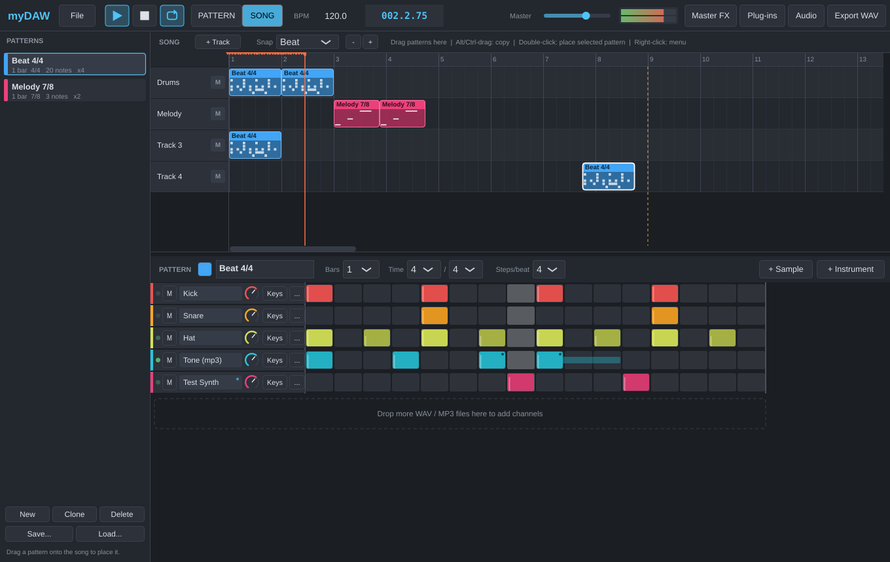

# myDAW

パターン（小節のブロック）を作って、パズルのように並べて曲を作るデスクトップ DAW です。
C++ / [JUCE](https://juce.com) 製で、Windows・macOS・Linux で動きます。



## できること

| 仕様 | 実装 |
| --- | --- |
| 取り込んだ音 (mp3, wav) を打ち込める | WAV / MP3 / AIFF / FLAC / OGG を読み込んでチャンネルにする。ステップグリッドとピアノロール（音程・長さ・ベロシティ）で打ち込み |
| 打ち込んだ音を小節ごとに保存できる（小節の長さは自由） | 「パターン」= 1 小節以上のブロック。小節数・拍子（3/4, 5/4, 7/8 …）・グリッド分解能（3 にすると 3 連符）を自由に設定。パターン単体を `.mdpat` ファイルに保存して、別の曲で読み込める |
| 保存した小節をパズルのように組み合わせて曲を作る | ソング画面のトラックにパターンをドラッグ＆ドロップ。ブロックは隣のブロックの端に磁石のように吸着するので、長さの違う小節もぴったり並ぶ |
| VST を読み込める | VST3 のインストゥルメント（シンセ等）と エフェクト（チャンネルごと / マスター）を読み込み、プラグイン画面を開いて操作。設定はプロジェクトに保存される（macOS では Audio Unit も可） |

そのほか: BPM 変更、ミュート、音量 / パン、パターン再生 / ソング再生の切り替え、ソングのループ、WAV 書き出し、
プロジェクトの保存 / 読み込み（`.mydaw`）。

## 画面と操作

```
┌ 上部 ─ File / ▶ ■ ループ / PATTERN・SONG / BPM / 位置 / マスター音量 / Master FX / Plug-ins / Audio / Export WAV
├ 左 ─── パターン一覧（New・Clone・Delete・Save...・Load...）
├ 右上 ─ ソング（トラックにパターンを並べる）
└ 右下 ─ パターンエディタ（ステップグリッド / ピアノロール）
```

### 1. 音を取り込む
- **+ Sample** ボタン、またはパターンエディタに WAV / MP3 を **ドラッグ＆ドロップ** → チャンネルが追加されます。
- **+ Instrument** → VST3 シンセを追加（先に **Plug-ins** でスキャンが必要。下記）。
- チャンネル名をクリックすると試聴、ダブルクリックで名前変更、右クリックでメニュー。
- **...** ボタン: 音量・パン・ルートノート（サンプルが元の音程で鳴る鍵盤）・ワンショット・エフェクト。

### 2. 打ち込む（パターンを作る）
- ステップグリッドのマスをクリックで ON / OFF、ドラッグで連続入力、右クリックで消去。
- **Keys** ボタンでピアノロール: クリックで音符追加、ドラッグで移動、右端ドラッグで長さ変更、右クリック / ダブルクリックで削除。
  サンプルも音程を変えて鳴らせます。
- Ctrl（または Alt）+ マウスホイールで音符のベロシティ（強さ）を変更。
- ヘッダーの **Bars**（小節数）・**Time**（拍子）・**Steps/beat**（分解能）で小節の長さを自由に決められます。
- **PATTERN** モードで ▶ を押すと、今のパターンをループ再生します（スペースキーでも再生 / 停止）。

### 3. 小節（パターン）を保存する
- 左のパターン一覧で **New**（新規）/ **Clone**（複製）。名前は一覧をダブルクリックかエディタ上部で変更。
- **Save...** でパターンを `.mdpat` ファイルに保存、**Load...** で別のプロジェクトに読み込み。
  使っているサンプル / プラグインの情報も一緒に保存されるので、読み込み先に無いチャンネルは自動で作られます。

### 4. パズルのように組み合わせる
- パターン一覧からソングのトラックへ **ドラッグ＆ドロップ**（または、トラックの空いている所をダブルクリック）。
- ブロックはドラッグで移動。**Alt / Ctrl + ドラッグでコピー**、Delete キーで削除、Ctrl+D で後ろに複製、右クリックでメニュー。
- **Snap** で吸着単位（小節 / 拍 / 1/2 / 1/4 / オフ）。さらに隣のブロックの端には自動で吸着します。
- ルーラー（小節番号の帯）をクリックするとその位置から **SONG** モードで再生。トラックの **M** でミュート。
- ソング中のブロックをクリックすると、そのパターンが下のエディタで開きます（同じパターンのブロックは全部一緒に変わります。
  1 つだけ変えたいときは右クリック →「Make unique」）。

### 5. VST を使う
1. **Plug-ins** → Options → 「Scan for new or updated VST3 plug-ins」でスキャン（初回のみ）。
   標準の場所: Windows `C:\Program Files\Common Files\VST3`、macOS `/Library/Audio/Plug-Ins/VST3`。
2. シンセ: パターンエディタの **+ Instrument**。エフェクト: チャンネルの **...** →「+ Add effect」、全体には **Master FX**。
3. プラグインの画面はチャンネル右クリック →「Open plug-in window」か、エフェクト行の **Edit**。

### 6. 書き出し
- **Export WAV**（Ctrl+E）でソング全体を 24bit WAV に書き出します。
- コマンドラインでも書き出せます: `myDAW --render song.mydaw out.wav [--samplerate 48000]`

### ショートカット
| キー | 動作 |
| --- | --- |
| Space | 再生 / 一時停止（■ を 2 回押すと先頭へ） |
| F5 / F6 | パターン再生 / ソング再生 |
| Ctrl+N / O / S | 新規 / 開く / 保存（Ctrl+Shift+S で別名保存） |
| Ctrl+E | WAV 書き出し |
| Delete, Ctrl+D | ソング: 選択ブロックの削除 / 複製 |

## ダウンロード

GitHub の **Actions** タブ → 最新の「Build」→ **Artifacts** から
`myDAW-Windows`（`myDAW.exe`）/ `myDAW-macOS`（`myDAW.app`）/ `myDAW-Linux` をダウンロードできます。

- macOS: 署名していないアプリなので、初回は右クリック →「開く」で起動してください。
- Windows: SmartScreen が出たら「詳細情報」→「実行」。

## ビルド方法

必要なもの: CMake 3.22 以上、C++17 コンパイラ（Windows: Visual Studio 2022 / macOS: Xcode / Linux: GCC または Clang）。
JUCE は CMake が自動でダウンロードします。

```bash
cmake -S . -B build -DCMAKE_BUILD_TYPE=Release
cmake --build build --config Release
```

実行ファイルは `build/MyDAW_artefacts/Release/` にできます。

Linux では先に次のパッケージを入れてください:

```bash
sudo apt install build-essential cmake ninja-build libasound2-dev libjack-jackd2-dev libfreetype-dev \
  libfontconfig1-dev libx11-dev libxcomposite-dev libxcursor-dev libxext-dev libxinerama-dev libxrandr-dev libxrender-dev
```

### テスト

```bash
cmake -S . -B build -DMYDAW_BUILD_TESTS=ON
cmake --build build --config Release
./build/MyDAWTests_artefacts/Release/MyDAWTests                        # エンジン・ファイル形式のテスト
./build/MyDAWTests_artefacts/Release/MyDAWTests Synth.vst3 Gain.vst3   # VST3 ホストのテストも実行
```

## ソースの構成

```
Source/
  Main.cpp             アプリ本体・コマンドライン書き出し
  AppCore.h            オーディオデバイス・プラグイン管理などの所有者
  Session.*            プロジェクトの操作（チャンネル / パターン / ソング / 保存・読み込み）
  Model/Project.*      データ構造（Note, Pattern, Clip, Track）
  Audio/AudioEngine.*  リアルタイム再生・シーケンサ・WAV 書き出し
  Audio/Channel.*      サンプラー / VST インストゥルメント + インサートエフェクト
  Audio/EffectChain.*  エフェクトプラグインの直列処理
  Audio/PluginManager.* VST3 のスキャン・読み込み
  UI/                  画面（TransportBar, PatternList, StepGrid, PianoRoll, PatternEditor, SongEditor ...）
Tests/IntegrationTests.cpp
```

## 現在の制限・今後のアイデア

- VST2 は非対応（Steinberg が SDK の配布を終了しているため）。VST3 と Audio Unit（macOS）に対応。
- Windows の ASIO は未対応（WASAPI / DirectSound で動作）。ASIO SDK を入れれば有効化できます。
- 元に戻す（Undo）、MIDI キーボード入力 / 録音、オートメーション、オーディオ録音はまだありません。
- プラグインのスキャンはアプリ内で行うため、壊れたプラグインがあるとスキャン中に落ちることがあります
  （その場合は再起動すると、そのプラグインを飛ばしてスキャンを続けられます）。

## ライセンスについて

JUCE は AGPLv3 / 商用のデュアルライセンスです。個人で使う分には問題ありませんが、
このアプリを配布・販売する場合は JUCE のライセンス条件（AGPLv3 でソース公開、または商用ライセンス）に従ってください。
